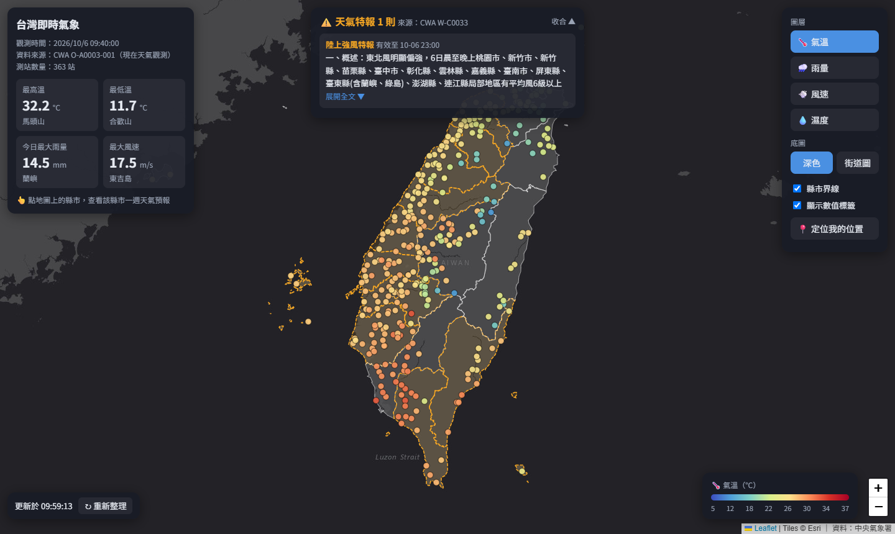
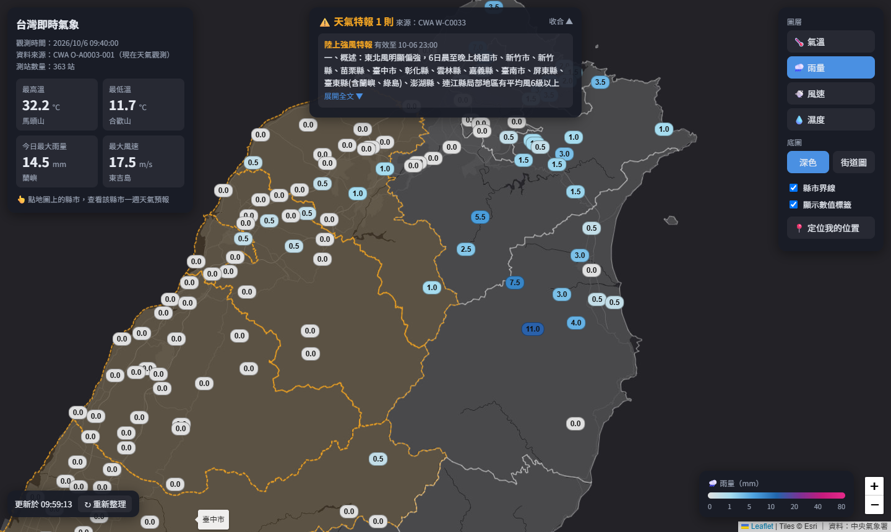
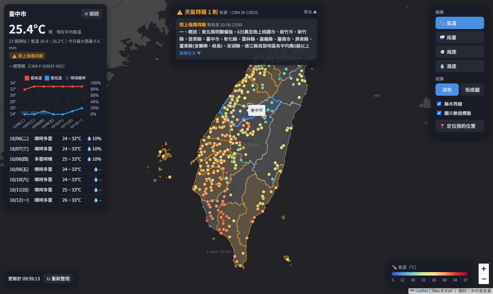

# 台灣即時氣象地圖

用中央氣象署（CWA）開放資料製作的互動式即時氣象地圖，以 **O-A0003-001（現在天氣觀測報告）** 為主，整合天氣特報與縣市一週預報，部署於 Vercel。

- **線上網站**：https://cwa-weather-map-eight.vercel.app/
- **GitHub**：https://github.com/Ollyye16/cwa-weather-map

## 功能介紹

### 1. 全台測站即時觀測地圖
- 全台 360+ 個氣象測站的即時觀測（CWA O-A0003-001），依數值以色階顯示在地圖上
- **圖層切換**：🌡️ 氣溫、🌧️ 今日累積雨量、💨 風速、💧 相對濕度，色階圖例隨圖層更新
- 放大後測站改以**數值標籤**顯示，縮小時顯示色點避免互相重疊
- 點測站顯示詳細資料：天氣、氣溫與今日高低溫、雨量、風速風向、濕度、氣壓、海拔

### 2. 全台統計卡
- 全台最高溫、最低溫、今日最大雨量、最大風速，以及發生的測站

### 3. 縣市界線與天氣特報
- 地圖上顯示 22 縣市界線，滑鼠移過去顯示縣市名稱
- **天氣特報面板**：顯示目前生效中的特報（如陸上強風、豪雨特報）、有效時間與全文（CWA W-C0033-001 / W-C0033-002）
- 有特報的縣市在地圖上以**橘色虛線**標示

### 4. 縣市一週天氣預報
- **點地圖上任一縣市**，左側顯示該縣市：
  - 現在平均氣溫、天氣、測站數、氣溫範圍、今日最大雨量（由測站即時資料計算）
  - 該縣市生效中的特報
  - **一週預報圖表**：最高溫、最低溫折線與降雨機率長條（CWA F-D0047-091）
  - 每日預報表：天氣、溫度範圍、降雨機率

### 5. 其他
- 底圖切換：深色 / 街道圖
- 定位我的位置（瀏覽器 Geolocation）
- 每 10 分鐘自動更新，也可手動「重新整理」

## 使用的 CWA 資料集
| 資料集 | 內容 | 用途 |
|---|---|---|
| O-A0003-001 | 現在天氣觀測報告 | 測站即時觀測、統計卡、縣市現在天氣 |
| W-C0033-001 | 各縣市目前天氣警特報 | 地圖標示有特報的縣市 |
| W-C0033-002 | 天氣特報全文 | 特報面板 |
| F-D0047-091 | 臺灣各縣市未來 1 週天氣預報 | 縣市一週預報圖表 |

## 架構
| 檔案 | 說明 |
|---|---|
| `index.html` | 前端：Leaflet 地圖、Chart.js 圖表、各面板 |
| `api/weather.js` | `/api/weather`：測站即時觀測（O-A0003-001） |
| `api/warnings.js` | `/api/warnings`：天氣特報（W-C0033-001、W-C0033-002） |
| `api/forecast.js` | `/api/forecast?county=臺北市`：縣市一週預報（F-D0047-091） |
| `api/_cwa.js` | 共用：呼叫 CWA API、回傳 JSON |
| `data/counties.json` | 縣市界線（TopoJSON，來源 [taiwan-atlas](https://github.com/dkaoster/taiwan-atlas)） |

- 後端使用 **Vercel Serverless Functions**，前端只呼叫自己的 `/api/*`
- **CWA 授權碼只存在 Vercel 的環境變數中**，不會出現在前端或 GitHub
- API 回應在 Vercel CDN 快取（觀測與特報 5 分鐘、預報 30 分鐘），避免頻繁呼叫 CWA

## 部署到 Vercel
1. 將此 repository Import 到 [Vercel](https://vercel.com/new)
2. 在 **Settings → Environment Variables** 新增 `CWA_API_KEY` = 你的 CWA 授權碼（到 [氣象資料開放平臺](https://opendata.cwa.gov.tw/) 註冊取得）
3. Deploy

資料來源：中央氣象署 開放資料平臺
